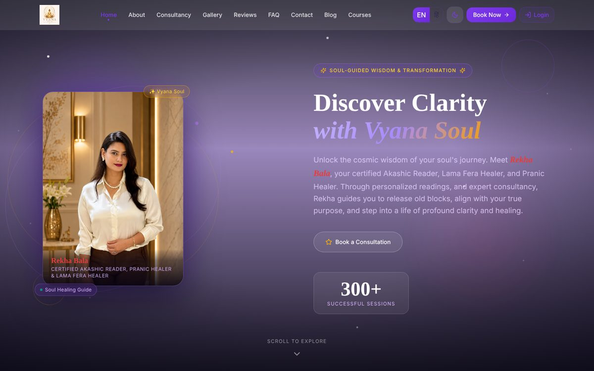
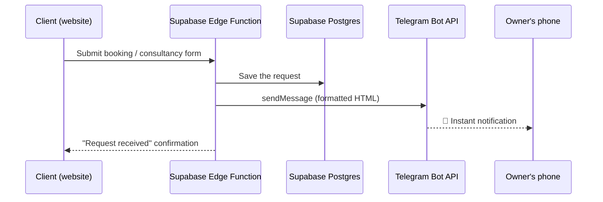
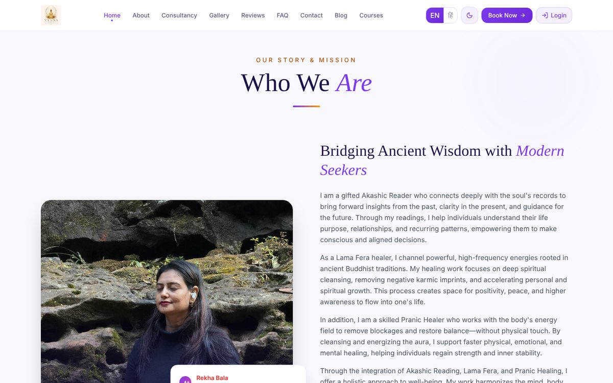
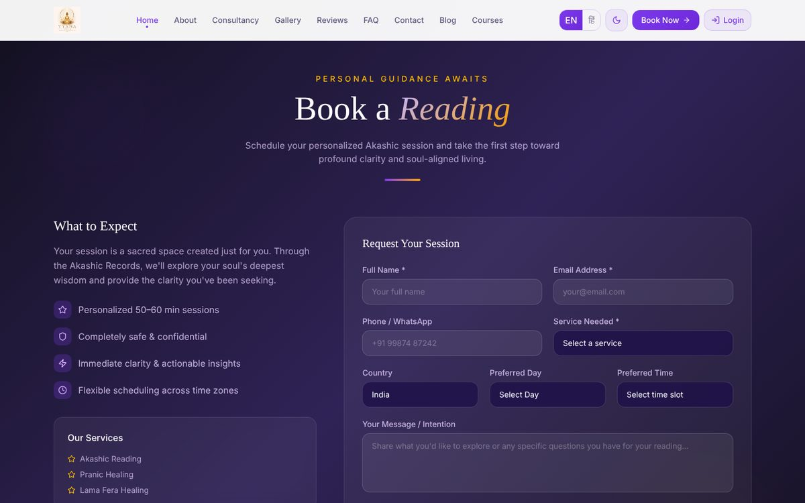
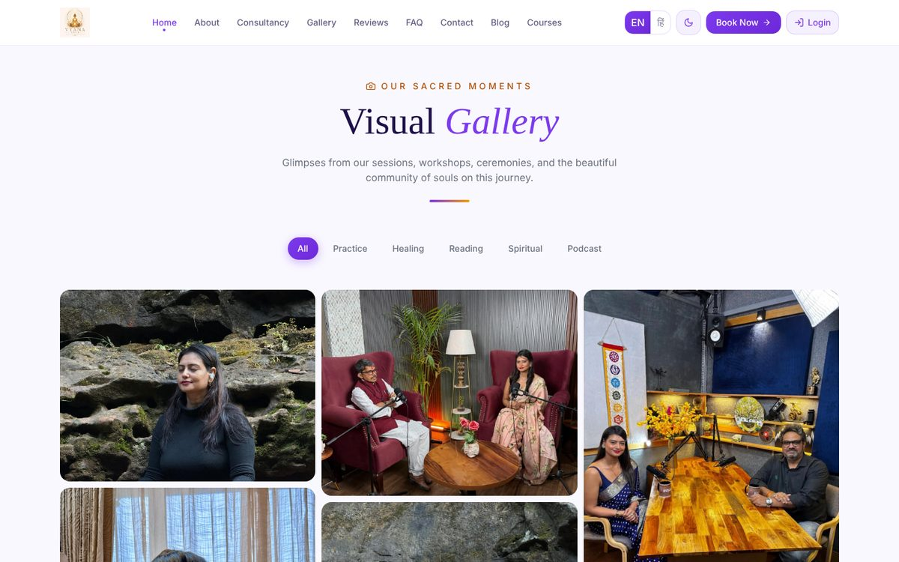
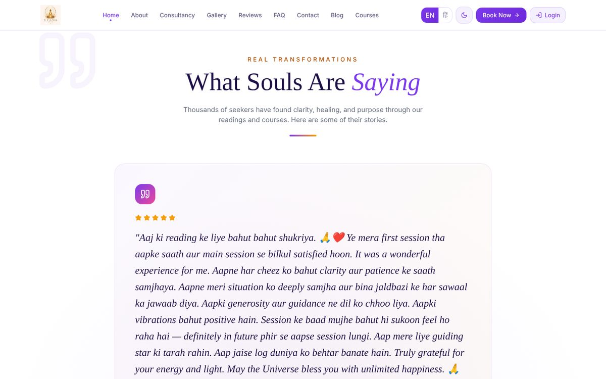
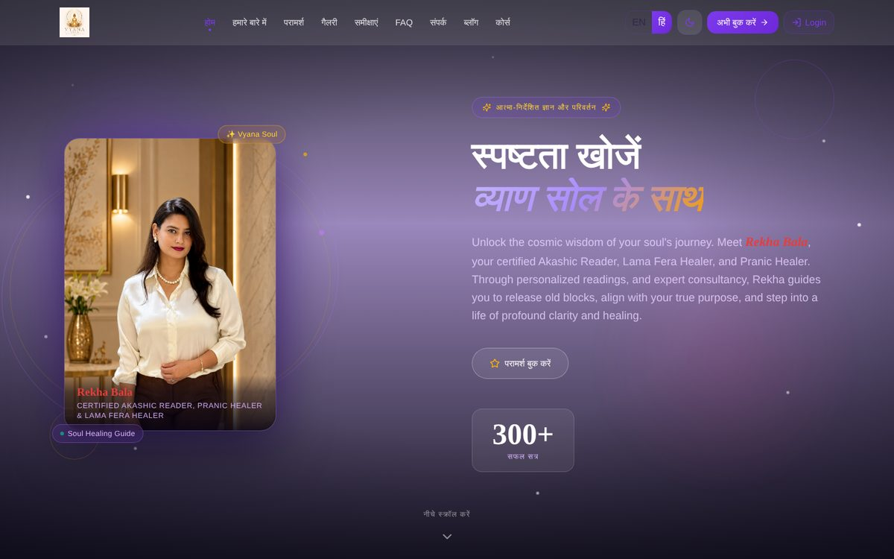
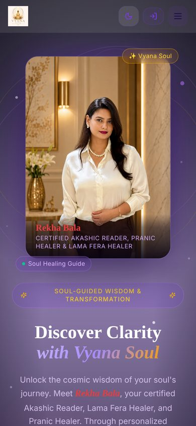
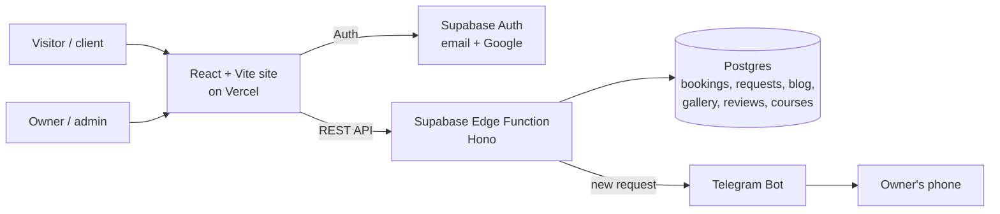

<div align="center">



# VyanaSoul: Spiritual Consultancy Platform

**A live, production website built for a real client: Akashic Readings, Pranic Healing, Lama Fera Healing, courses and online consultations.**

[](https://vyanasoul.com)


</div>

---

## About this project

VyanaSoul is my **first freelance project**. The client, Rekha Bala, is a certified Akashic Reader, Pranic Healer and Lama Fera Healer. She needed one place online where people could learn about her work, trust her, and book a session without endless back-and-forth on WhatsApp.

I took the project from the first conversation to a live product: understanding what the business needed, designing the site, building the frontend and backend, connecting a database and login, adding a Telegram alert system for the owner, and deploying it at **[vyanasoul.com](https://vyanasoul.com)**. The site is used by real clients, not built as a demo or college assignment.

## Understanding the client's needs

Before writing code, I worked out what the business actually needed. Each need became a feature:

| What the client needed | What I built |
|---|---|
| Look trustworthy and calm to first-time visitors | A soft purple-and-gold design, her own photos, a story-led About section, real client testimonials and a session counter |
| Let people book a reading easily, from India or abroad | A booking form with service, country, preferred day and time slot, so time zones are handled up front |
| Never miss a new booking, even when away from a computer | **Instant Telegram notifications** to the owner's phone for every booking and consultancy request |
| Reach Hindi-speaking clients as well as English speakers | A one-tap **English / Hindi** language switch across the site |
| Update content without calling a developer | An **admin panel** to manage bookings, requests, gallery photos, blog posts, reviews and courses |
| Let clients see their own bookings | Email and **Google sign-in** with a personal dashboard |
| Grow later with paid courses and articles | A blog and a courses section ready for enrolments |

## Features

**For visitors and clients**
- Home, About, Consultancy, Gallery, Reviews, FAQ and Contact sections on one smooth-scrolling page
- Booking form for Akashic Reading, Pranic Healing and Lama Fera Healing
- Photo gallery with category filters (Practice, Healing, Reading, Spiritual, Podcast)
- Testimonials, FAQ, blog and courses pages
- English and Hindi versions, with the choice remembered
- Light and dark mode
- Fully responsive on phones, tablets and desktops
- Sign up with email or Google, then track bookings and course enrolments in a personal dashboard

**For the owner (admin)**
- Admin panel inside the dashboard, available only to admin accounts
- View every consultancy request and booking, and move it through statuses such as *new → in progress → completed* or *pending → confirmed → cancelled*
- Add or remove gallery photos
- Write, edit, publish or hide blog posts
- Add, edit and delete reviews
- Create and manage courses
- **Telegram alert on her phone the moment someone books**

## Telegram notification system

The owner does not sit at a computer all day, and checking a dashboard for new bookings is easy to forget. So every time someone submits the booking or consultancy form, the backend sends a formatted message straight to the owner's Telegram group, and she can reply to the client within minutes.



What the owner receives on Telegram for each request:

```text
🔔 New Consultancy Request

Name: …
Email: …
Phone: …
Service: Akashic Reading
Country: India
Preferred Day: …
Time: …
Message: …
```

How it was designed:
- **Never blocks the client.** The request is saved to the database first. If Telegram is slow or down, the error is logged and the client still gets a success message, so no booking is lost.
- **Safe formatting.** User input is HTML-escaped before it is sent, so a message can't break the Telegram formatting.
- **Catch-up option.** A resend route can re-send the latest requests to Telegram if notifications were ever missed.

## Screenshots

| | |
|---|---|
| **About: the client's story** <br>  | **Booking form** <br>  |
| **Gallery with category filters** <br>  | **Real client testimonials** <br>  |
| **Hindi version** <br>  | **Mobile view** <br>  |

## Tech stack

| Layer | Tools |
|---|---|
| Frontend | React 18, TypeScript, Vite, React Router 7 |
| Styling and UI | Tailwind CSS 4, shadcn/ui (Radix UI), Motion for animations, Lucide icons |
| Backend | Supabase Edge Function (Deno + Hono) exposing a REST API |
| Database | Supabase Postgres with row-level security |
| Authentication | Supabase Auth: email/password and Google OAuth |
| Notifications | Telegram Bot API |
| Hosting | Vercel (frontend), Supabase (backend and database) |
| Design | Figma |

## How it fits together



**Main API routes** (served by the edge function):

| Area | Routes |
|---|---|
| Bookings | `GET/POST /bookings`, `PATCH /bookings/:id/status`, `DELETE /bookings/:id` |
| Consultancy requests | `GET/POST /consultancy`, `PUT /consultancy/:id/status` |
| Content | CRUD for `/gallery`, `/blog`, `/reviews`, `/courses` |
| Users | `POST /auth/signup`, `GET/PUT /profile`, `GET/POST /enrollments` |

## Project structure

```text
src/app/
├── pages/          Home, Blog, Courses, Dashboard
├── components/
│   ├── sections/   Hero, About, Consultancy, Gallery, Testimonials, FAQ, Contact, Courses
│   ├── ui/         shadcn/ui components
│   └── AdminPanelFull.tsx
├── context/        Auth, Language (EN/HI), Theme (light/dark)
└── data/           Translations, FAQs, testimonials, courses, blog seed data
supabase/
├── functions/      Edge function: REST API + Telegram notifications
└── migrations/     Database tables and row-level security policies
```

## Run it locally

```bash
git clone https://github.com/aryanjain281005/buildspiritualconsultancywebsite.git
cd buildspiritualconsultancywebsite
npm install
npm run dev
```

The site opens at `http://localhost:5173`. Bookings, login and the admin panel need your own Supabase project (database tables from `supabase/migrations`, and the edge function in `supabase/functions` deployed), plus a Telegram bot token and chat ID for notifications.

## What I learned

- **Turning a client conversation into a feature list.** The client described problems ("I miss messages", "my clients speak Hindi"), and my job was to turn those into concrete features.
- **Building a full product alone:** design, frontend, backend API, database, authentication, deployment and a custom domain.
- **Designing for a non-technical owner:** an admin panel and phone alerts matter more to her than any technical detail.
- **Reliability over cleverness:** saving the booking before notifying, and never letting a third-party service break the main flow.
- **Supporting a live site:** fixing issues and adding features after launch while real people were using it.

## About me

I'm **Aryan Jain**, a B.Tech Computer Science student at IIIT Naya Raipur, interested in AI and building useful products. I design in Figma and build full-stack web and mobile apps.

**Need a website for your business?** I take freelance projects: business and portfolio sites, booking systems, admin dashboards and automation like Telegram alerts. Reach out through my [GitHub profile](https://github.com/aryanjain281005).

---

<div align="center">

Built with care for **Vyana Soul** · Live at **[vyanasoul.com](https://vyanasoul.com)**

<sub>Uses components from <a href="https://ui.shadcn.com/">shadcn/ui</a> (MIT) and photos from <a href="https://unsplash.com">Unsplash</a>. See <a href="ATTRIBUTIONS.md">ATTRIBUTIONS.md</a>.</sub>

</div>
